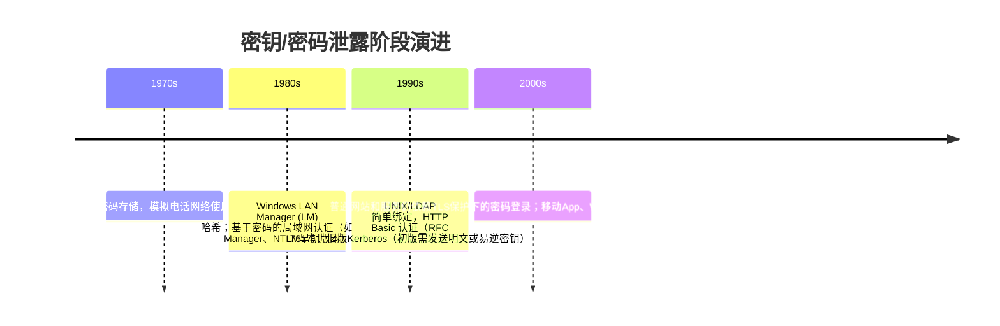
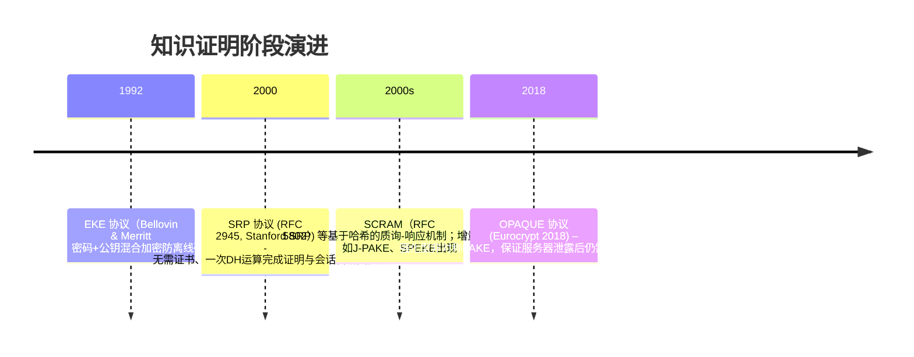
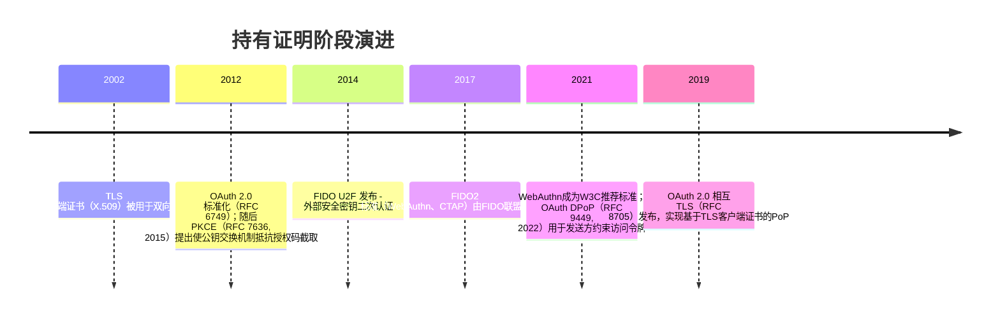

## 1. Secret Disclosure 阶段
**定义：** Secret Disclosure 指客户端认证中明文（或易逆转换形式）的密码或密钥被发送或泄露给服务器的模式。在此阶段，客户端“拥有”密码，认证时往往将密码直接（或经简单哈希）提交给服务器，服务器端验证密码，这意味着服务器必须存储用户的密码或密码哈希。该模式实现简单，但若服务器或通信链路被攻破，密码即被泄露。

**历史演进（Mermaid 时间线）：**

早期的认证机制如电话网络的ESN/MIN简单匹配（只验证身份标识，不验证持有者），以及模拟/2G 网络使用SIM卡和共享秘密（鉴权中心与SIM中存放Ki）构成原型。随着PC和互联网普及，诸如**HTTP Basic**认证（客户端发送用户名和密码的Base64）、**UNIX/etc/shadow**口令文件（弱哈希密码）等广泛应用，这些方式都属于Secret Disclosure。实践中，即使传输使用TLS保护，服务器端仍然以明文形式验证密码（在TLS解密后），而服务器若被攻破，可直接获得所有用户密码。

**典型协议/算法：**  本阶段没有强加密协议，重点是将用户密码作为共享秘密直接用于认证。常见场景包括：HTTP Basic/Digest（RFC 7617/7616，Digest仅对口令做质询-响应但服务端仍需存储哈希）、传统LDAP简单绑定、早期Kerberos（需发送加密票据但初始阶段可能暴露明文密码）等。

**代表性实现与部署案例：**  如 Microsoft AD 的早期 NTLMv1/v2、OpenLDAP 简单绑定、众多Web应用的用户名/密码登录（如早期论坛、邮件系统）、以及无线网络的预共享密钥模式（WPA-PSK）。由于安全风险大，如LinkedIn、Adobe等泄露事件表明密码数据库被盗将导致大面积泄露，这一阶段已被业界逐步淘汰。

**小结：** Secret Disclosure 模式实现简单但极易受损，一旦服务器或通信链路被攻破，所有密码即告泄露。它缺乏抗中间人和抗重放能力，现代最佳实践已推荐弃用明文密码传输，转向下文的挑战-响应或公钥方案。

## 2. Proof of Knowledge 阶段
**定义：** Proof of Knowledge (知识证明) 阶段的认证协议允许客户端证明其“知道”密码等秘密，而不直接泄露密码本身或其可逆表示。常见形式是客户端和服务器进行互动质询-响应，利用密码参与计算（如生成响应或会话密钥），以此完成身份验证。这类协议通常基于密码认证密钥交换（PAKE），具有抵抗离线字典攻击的安全性特征。

**历史演进（Mermaid 时间线）：**

早期代表性工作是1992年提出的**EKE**（Encrypted Key Exchange），该协议使用公钥加密来保护密码避免离线猜测攻击。之后的**密码认证密钥交换协议**（PAKE）如SRP、J-PAKE、SPAKE等不断涌现。2000年Stanford提出**SRP**（Secure Remote Password）协议（RFC 2945），只需单轮Diffie-Hellman计算即可在无证书环境下完成安全认证和会话密钥协商，且客户端无需存储长期密钥。2018年提出的**OPAQUE**为更现代的非对称PAKE，提供前向安全性且避免服务器泄密带来的预计算攻击，成为新一代密码认证方案。

**典型协议/算法：**  包括SRP（RFC 2945）、SCRAM（RFC 5802）等基于Salted Challenge-Response的SASL机制、EAP-PWD（802.1X环境下的PAKE）、J-PAKE、SPEKE、SRP-TLS、密码分段OTP（如OCRA）等。各种PAKE协议均属于知识证明类别。其特点是服务器仅保存经盐哈希或变换后的“验证器”，即使泄露也不能直接获知密码。

**代表性实现与部署案例：**  SRP协议被OpenSSL、GnuTLS等库支持，可用于TLS-SRP环境。SASL SCRAM在邮件服务器（如Dovecot、Postfix）和数据库（如MongoDB、RabbitMQ）中广泛应用。面向普通用户，很多服务提供一次性密码（OTP）或TOTP/Google Authenticator等作为挑战-响应机制的变种。1999年微软Kerberos V5引入了质询-响应预认证（Pre-auth）以防止被动监听。近期，苹果iCloud Keychain内部也基于密码PAKE保护同步数据。

**安全性与攻击面：**  PoK协议通过交互或零知识证明避免发送明文密码，对被动窃听和主动中间人攻击有较好防护（前提是协议设计正确）。如SRP宣称可防止被动主动攻击，一轮运算即完成认证，同时服务器密码表公开也不会危及安全。抵御重放攻击通常依赖挑战中包含随机数或时间戳等机制。缺点是服务器仍需要存储经盐哈希的验证器，若泄露可进行离线暴力猜测（但相较Secret Disclosure耗时更长）。实现不当还可能受侧信道影响（如固定密码运算泄漏）。

**隐私：**  PoK方案本身不额外收集身份信息，使用挑战-响应理论上对第三方不可验证密码内容。但同一密码验证器往往在多次认证中固定，第三方观察到会话或令牌时可能关联会话。无密码同步机制的情况下丧失匿名性。相比之下，此阶段还未真正脱离密码，隐私保护水平有限。

**小结：** Proof of Knowledge 阶段在密码认证上大幅提升了安全性：协议可抵抗窃听和主动攻击，避免了明文密码传输，并使服务器密码泄露的影响被限制到离线破解。然而，该阶段仍依赖密钥/密码的知识拥有，无法完全防止服务端泄露带来的密码猜测风险，也未根本解决可用性问题，逐步为下一阶段的持有证明方案所替代。

## 3. Proof of Possession 阶段
**定义：** Proof of Possession (持有证明) 阶段的认证方式转变为客户端证明其“持有”某个秘密材料（通常是私钥或硬件设备），而无需证明对某个共享秘密的知识。这包括基于公钥基础设施或安全元件的认证：客户端持有私钥，在认证时使用私钥生成签名或证明（如TLS客户端证书、FIDO2/WebAuthn、OAuth DPoP/MTLS）。服务器仅验证签名，不接触或储存私钥。

**历史演进（Mermaid 时间线）：**

此阶段核心是引入公钥和硬件身份认证技术。2002年TLS双向认证（客户端证书）使服务器可以通过客户端发送的X.509证书验证身份，但因用户体验差未广泛使用。进入移动互联网时代，复杂的认证需求促使业界采用如下方案：**OAuth 2.0 PKCE**（2015年发布RFC 7636），要求客户端在授权流程中提供基于SHA256的令牌挑战，应对授权码截取；**OAuth 2.0 Mutual TLS**（RFC 8705，2019）允许将客户端证书与访问令牌绑定；**OAuth DPoP**（RFC 9449，2022）提供应用层公钥绑定机制。最具革命性的进展来自FIDO标准：2014年推出FIDO U2F（USB/NFC安全密钥）用于二因素认证，2017年FIDO2（包括W3C WebAuthn 和 CTAP协议）发布。WebAuthn为应用提供浏览器级API，实现生物特征或安全密钥的无密码登录。

**典型协议/算法：**  这一阶段涵盖多种公钥和硬件机制：TLS/SSL 双向认证、X.509 客户端证书认证、PKI 基础设施；OAuth/OIDC 中的**Public Key JWT**（客户端凭JWT签名）和**MTLS/DPoP**机制；**FIDO2/WebAuthn**协议（客户端生成公私钥对，使用设备PIN/生物特征授权）；**零信任硬件认证**（HSM、TPM、Secure Enclave 存储私钥并本地签名）。每种模式的核心都是让客户端在本地安全地生成/持有密钥，用签名的方式证明身份。

**代表性实现与部署案例：**  Web平台与移动端：谷歌、微软、Facebook 等服务均支持FIDO/WebAuthn，用户可通过指纹、人脸或安全密钥（如YubiKey）登录。现代浏览器和操作系统内置对WebAuthn的支持；Android和iOS密码管理器已开始使用统一的“passkey”概念实现跨设备登录。企业领域：VPN/无线网络常用CA签发的客户端证书；OAuth提供商（Auth0、Okta等）支持MTLS和DPoP绑定访问令牌。硬件安全模块（HSM）和TPM被用于保护高价值密钥，如区块链钱包、数字证书签发系统等。

**安全性与攻击面：**  PoP方案通过公钥签名或硬件加密认证，显著提升了对网络攻击的抵抗能力。使用TLS客户端证书或WebAuthn等手段能有效防止中间人和重放攻击，因为私钥永不离开客户端，而每次认证均有服务器随机质询或绑定签名。如DPoP中每个请求均带有新的签名令牌，可防盗用令牌。PoP方案通常对密码喷射、钓鱼高度免疫：FIDO标准设计即抗钓鱼、保护隐私。可用性上，持有证明用户需使用额外设备或凭证（安全钥匙、手机、TPM芯片），部署门槛高、用户初期不便，且遗失设备需恢复策略。侧信道风险主要在硬件泄露或未受信硬件身份认证（如WebAuthn中某些认证器漏洞）。

**隐私：**  公钥认证方案一般不暴露可跨服务追踪的信息。FIDO2/WebAuthn使用每个服务独立生成的密钥对，并不共享可识别用户身份的标识；设备验证信息（如生物特征）保留在终端，不发送给服务器。OAuth DPoP/MTLS等机制仅绑定临时令牌与公钥，也不会泄露用户敏感信息。但需要注意的是，客户端证书和TPM设备标识可能在不当管理下被滥用来关联用户活动。

**小结：** Proof of Possession 阶段依托公钥和硬件证明，从根本上解决了Secret Disclosure和PoK的安全不足。持有私钥的客户端通过签名证明身份，不泄露密码，能有效抵抗被动窃听、中间人、令牌窃取等攻击。其提供的密码无关、可移植和可撤销方案显著提升安全性和用户隐私性。然而，这类方案的可用性和部署复杂度也随之增加，需要处理设备丢失恢复、多设备同步和遗失后的访问策略等问题。

## 4. Proof of Knowledge vs Proof of Possession 对比

| 属性              | 知识证明 (PoK)                                                                 | 持有证明 (PoP)                                                              | 评分 (1-5) & 说明                                                                                                   |
|-------------------|--------------------------------------------------------------------------------|-----------------------------------------------------------------------------|---------------------------------------------------------------------------------------------------------------------|
| **抗窃听**        | 中等（依赖TLS保护; 协议本身可防止明文泄露）                                    | 高（认证过程基于签名，窃听无法获得秘密）                                    | PoK: 3；PoP: 5。PoK在TLS通道下安全，但仍在信任TLS的前提下；PoP无需传输秘密，在无保护环境下也安全。                  |
| **抗中间人**      | 较好（协议中使用挑战防重放，但需保证服务器公钥或验证器安全）                   | 极高（使用公钥/证书体系，MITM难以伪装；如DPoP绑定令牌与公钥）               | PoK: 3；PoP: 5。PoP方案依赖服务器验证公钥签名，MITM难以插入；PoK需依赖附加流程防止中间人。                          |
| **抗重放**        | 良好（每次交互含随机挑战/Nonce）                                               | 良好（签名中的时间戳/ID防重放）                                             | PoK: 4；PoP: 4。两者都通常包含Nonce或序列号抵抗重放攻击。PoP在令牌级别也可验证防重放。                              |
| **抗侧信道**      | 较差（客户端或服务器侧若实现有泄露风险；服务器存储密码哈希被盗可离线暴力破解） | 较好（私钥受硬件保护，如TPM/安全芯片；泄密难以快速伪造）                    | PoK: 2；PoP: 4。PoK暴露密码/哈希，在物理或逻辑侧信道攻击下容易泄露；PoP一般依赖硬件保护，可减少侧信道威胁。         |
| **隐私保护**      | 一般（服务器可关联多次认证记录；无第三方隐私保护）                             | 良好（按服务分隔密钥，不共享用户身份；生物识别不出网；OAuth方案与令牌绑定） | PoK: 3；PoP: 5。PoP方案（如FIDO/WebAuthn）设计了跨站点不可链接的密钥，且不上传用户生物特征，隐私性更强。            |
| **用户体验 (UX)** | 友好（仅密码输入；广泛兼容）                                                   | 较复杂（需额外设备或身份验证步骤；需要安装/注册硬件设备）                   | PoK: 4；PoP: 2。PoK就像普通密码登录，易用；PoP引入硬件凭证/生物验证，初期可能需适应（但长期看便捷，省去记忆密码）。 |
| **性能**          | 优秀（计算开销小，仅哈希和简单运算）                                           | 较差（公钥签名和TLS握手开销大；需与硬件或PKI交互）                          | PoK: 5；PoP: 3。PoP在客户端和服务端都需较重的加密计算和网络握手，性能开销明显大于PoK。                              |
| **兼容性**        | 高（几乎所有平台/协议都支持密码机制）                                          | 中等偏低（需要TLS 1.2+或浏览器/系统支持；旧环境兼容差）                     | PoK: 5；PoP: 3。老旧系统无须改造即可使用密码；部署PoP常需升级TLS库、浏览器支持和硬件设备。                          |
| **密钥管理**      | 简单（用户记忆/服务器存储哈希）                                                | 复杂（需要存储私钥/公钥、设备管理，多设备同步）                             | PoK: 3；PoP: 2。PoK只需密码管理，用户和服务端易管理；PoP需管理公私钥对、备份/同步方案。                             |
| **恢复与迁移**    | 简单（忘记密码可重置；平台迁移易）                                             | 挑战较大（设备丢失需备份机制；不同平台间迁移困难）                          | PoK: 4；PoP: 2。密码重置流程成熟；持有证明需考虑多设备绑定、遗失补救方案（例如多张安全密钥或账户恢复助记词）。      |

## 5. 常见实现模式
- **SRP (Secure Remote Password)：** 基于离散对数的PAKE协议，实现双方通过密码交换会话密钥且不泄露密码。优点是无需信任第三方证书，只要服务器存储口令验证器即可；缺点是需要定制化支持，兼容性不如标准TLS。适用于对称密钥环境，如自建服务端。部署难度中等，已有开源库支持。
  ```kotlin
  // SRP 客户端示例（伪代码）
  val username = "<用户名>"
  val password = "<密码>"
  val srp = SrpClient(params) 
  val A = srp.generateA()                // 生成客户端公钥A
  // 发送A至服务器，接收盐salt和服务器公钥B
  val S = srp.computeSharedSecret(B, salt, password)  // 计算共享秘钥
  val M1 = srp.computeClientEvidence()    // 计算客户方证据（签名响应）
  // 发送M1至服务器进行验证，完成认证
  ```  

- **PAKE（通用）：** 如J-PAKE、OPAQUE等。J-PAKE无需PKI，以零知识方式证明密码知识；OPAQUE（近期标准）保证服务器泄密后需逐个暴力破解密码。优点包括强抵抗离线攻击和前向安全；缺点是算法复杂、计算开销大。适合对安全要求极高的场景。部署难度高，需遵循最新标准并使用专门库。示例伪代码略。

- **零知识证明（ZKP）：** 如使用zk-SNARK/zk-STARK等通用ZKP来验证秘密。虽然学术上可行，工程实践中几乎未用于交互式登录（开销大、实现复杂）。优点是极强的安全证明；缺点性能和复杂性使其尚未在客户端密码验证中应用。

- **签名挑战-响应：** 客户端对服务器挑战（随机数）使用密码衍生秘钥签名。典型例子是基于HMAC或对称密钥的质询响应。优点协议简单；缺点服务器需保存密钥/哈希，安全性不如PAKE。适用于遗留系统，如早期的HTTP Digest或TACACS+等。部署难度较低，许多网络设备和协议有支持。

- **OAuth/OIDC 相关：** 例如**PKCE**（Proof Key for Code Exchange）：公网上（如移动端、SPA）验证授权码不会被截取，客户端生成随机字符串code_verifier并发送code_challenge，增加一次性校验，防窃听攻击。示例：
  ```kotlin
  // OAuth2 PKCE 示例
  val codeVerifier = "<随机字符串>"  // 存储以备后续使用
  val bytes = MessageDigest.getInstance("SHA-256").digest(codeVerifier.toByteArray())
  val codeChallenge = Base64.getUrlEncoder().encodeToString(bytes)  // SHA256->Base64
  // 在授权请求中包含code_challenge与校验方法（S256）
  ```  
  **DPoP**（Demonstration of Proof-of-Possession，RFC 9449）：绑定访问令牌与客户端公钥，每次请求提交包含签名的JWT证明其持有私钥。优点可防Token被盗用；缺点客户端需能安全存储私钥（如浏览器本地Storage）。

- **FIDO2/WebAuthn：** 基于公私钥对和可选的生物认证。用户注册时设备生成公私钥对并将公钥上报，登录时需触发硬件或软件认证（如指纹、PIN），浏览器通过API完成签名请求。优点包括极强的抗钓鱼和隐私保护（每个网站密钥互不关联）；缺点需要用户和服务器支持该标准。部署难度中等，主流浏览器和平台已内建支持。示例代码（JavaScript）：
  ```javascript
  // 注册时生成凭据
  const publicKeyOptions = { /* WebAuthn 创建选项，包括挑战challenge等 */ };
  const credential = await navigator.credentials.create({publicKey: publicKeyOptions});
  // 登录时生成签名
  const requestOptions = { /* WebAuthn 请求选项，包括挑战 */ };
  const assertion = await navigator.credentials.get({publicKey: requestOptions});
  ```  

- **客户端证书/MTLS：** 服务器通过TLS要求客户端出示X.509证书。优点是标准化、由操作系统/浏览器支持；缺点用户体验差（需安装证书）、跨平台管理复杂。部署难度较高，通常用于企业VPN、API安全。Powershell示例（生成证书）：
  ```powershell
  PS> New-SelfSignedCertificate -Type SSLClientAuthentication -DnsName "client.example.com" -CertStoreLocation "Cert:\CurrentUser\My"
  ```  
  然后配置客户端应用加载该证书进行TLS握手。

- **HSM/TPM/Secure Enclave：** 利用硬件安全模块生成和存储密钥（如Android KeyStore、iOS Secure Enclave、TPM芯片）。客户端应用调用硬件API进行签名，私钥无法导出。优点高度安全；缺点依赖硬件、开发复杂。示例（Android Keystore）：
  ```kotlin
  val kpg = KeyPairGenerator.getInstance(KeyProperties.KEY_ALGORITHM_RSA, "AndroidKeyStore")
  kpg.initialize(
    KeyGenParameterSpec
    .Builder("authKey", KeyProperties.PURPOSE_SIGN or KeyProperties.PURPOSE_VERIFY)
    .setDigests(KeyProperties.DIGEST_SHA256)
    .setUserAuthenticationRequired(true)
    .build()
  )
  val keyPair = kpg.generateKeyPair()
  // 使用 keyPair.private 进行签名认证
  ```  

每种模式的优缺点和适用场景各有不同。表格总结如下：

## 6. 迁移路线图（从PoK到PoP）

为平滑过渡，推荐采取分阶段策略并保留向后兼容：

| 阶段               | 步骤与措施                                                                                                                                      | 兼容与回滚方案                                                                                |
|--------------------|-------------------------------------------------------------------------------------------------------------------------------------------------|-----------------------------------------------------------------------------------------------|
| **评估与规划**     | 评估现有系统对PoP的支持度，选择首批适合用户群（高风险账户、多因素用户）进行试点。制定多设备绑定、丢失设备恢复方案。                             | 保留传统密码认证作为备用方案；监控新旧方式的故障率和用户反馈。                                |
| **试点与渐进部署** | 在部分用户/服务上启用PoP（如允许密码+安全密钥双认证），收集问题和性能数据；内部员工或高价值账号优先试用。                                       | 对支持新方式的客户端进行标记（如浏览器支持WebAuthn）；对于不支持的设备继续使用旧密码认证。    |
| **广泛推广**       | 在所有新用户或账户开通时默认注册PoP凭证（如在注册或登录过程中提供Passkey/OTP选项），并逐步强制要求现有用户绑定PoP设备。提供清晰指南和帮助文档。 | 持续允许使用一次性密码/PIN等回退策略；若发生兼容性/性能问题可短期回退到仅密码验证。           |
| **完全切换**       | 一旦PoP普及率高（>X%）且系统稳定，可将密码认证降级为次要或仅用于恢复流程。移除对明文密码保存和哈希的依赖。                                      | 保留紧急回滚路径（通过管理员控制台禁用PoP登录，使用户暂时回退到密码登录）。持续监控安全事件。 |
| **监控与优化**     | 跟踪关键指标：PoP注册/使用比例、登录成功率、客户支持请求、认证延迟、失败原因等；分析因设备丢失、迁移失败造成的影响。及时优化用户流程。          | 如果指标恶化或用户流失率升高，暂缓推进并调查原因。开发统计仪表盘监测使用情况。                |
| **风险评估**       | 识别主要风险：设备丢失导致无法登录、旧系统兼容性不足、用户抗拒新流程等。制定措施：提供多张安全密钥、云端Passkey同步、备用验证码等。             | 定期演练恢复场景（如使用备份码登录），提前通知用户可用的辅助验证方法。                        |

- **时间与资源：** 具体时间视项目规模与复杂度而定（未指定）。通常需要数月到一年准备期（包括需求分析、工具开发、用户教育），并行运行阶段可能持续半年以上。
- **测试与监控：** 验证功能正确性（身份验证成功/失败情况），监控认证延迟、错误率。可设定预警，如新注册设备成功率低于某阈值时报警。使用A/B测试评估用户接受度。
- **缓解措施：** 对发现的问题及时修正，例如优化硬件交互界面、增加兼容老设备的Fallback、加强用户培训。

## 参考来源
- Bellovin S. M. & Merritt M.，《Encrypted Key Exchange: Password-Based Protocols Secure Against Dictionary Attacks》，IEEE Symposium on Security and Privacy (1992)。
- Thomas Wu，**RFC 2945**《The SRP Authentication and Key Exchange System》（2000）。
- Stanislaw Jarecki 等，《OPAQUE: An Asymmetric PAKE Protocol…》Eurocrypt 2018。
- Jeff Hodges 等，W3C《Web Authentication: An API for accessing Public Key Credentials》规范（FIDO2/WebAuthn，2021）。
- FIDO Alliance，《FIDO2 认证规范概览》；FIDO Alliance《Passkeys概念介绍》（2024）。
- IETF OAuth工作组，**RFC 9449**《OAuth 2.0 Demonstrating Proof of Possession (DPoP)》；OAuth.net《OAuth 2.0 安全扩展：DPoP 与 MTLS》。
- Auth0 文档《Demonstrating Proof-of-Possession (DPoP)》。
- 等其他相关文献与标准文档（RFC 6749/7636/8705/5802，NIST SP800-63，IEEE P1363.2 等）。
