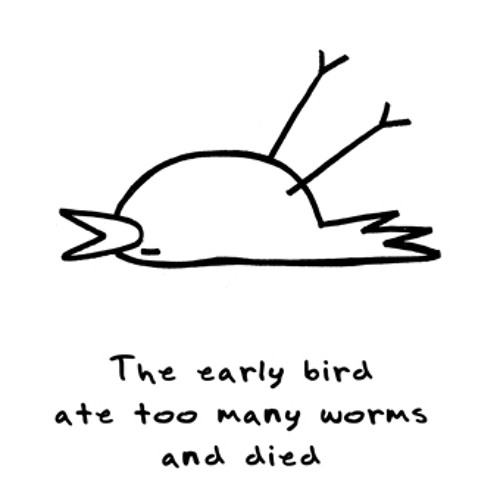

有一张图我见过很多次：一只简笔画风格的鸟，躺在地上，旁边写着：

> the early bird ate too much and died

第一次看到的时候笑了一下，然后就滑过去了。后来某天又想起来，忽然好奇这张图到底出自哪里。于是花了点时间去追。追的过程比结果有意思，记在这里。

## 先找到的是一句话，不是一张画

这句话有个明确的靶子。英语里有一句老谚语：

> The early bird catches the worm.
> 早起的鸟儿有虫吃。

而这张图把它拧成了：

> The early bird ate too much and died.
> 早起的鸟儿吃太多，撑死了。

反转的力度正好：把一句用来劝人勤奋、催人早起的话，直接砸成「努力的下场就是死」。这类东西有个名字，叫 anti-motivational meme，反励志梗。再配上一只画得极其敷衍、已经躺平的小鸟，笑点就成立了。

所以它很可能不是哪部作品里的固定台词，而是从这句谚语上长出来的一根枝。

顺着这句话往回找，目前能确认的是：**至少 2012 年，网上就已经有文字版本了**。比如德国 PocketPC 论坛那个 [Apple 用户闲聊帖](https://www.pocketpc.ch/apple-smalltalk/156776-apple-user-stammtisch-ot-38.html)里，有人在 "Early bird catches the worm" 后面接了一句 "The early bird ate too much worms and died"。

那个阶段能确认的只有这些：文字版本至少到 2012 年；这张死鸟简笔画具体出自哪位画师、哪个网站、哪条最初的帖子，都没有找到足够证据。所以如果网上有人说它出自某某漫画、某某动画，最好先持怀疑态度。它的核心笑点很清楚，就是建立在对 "The early bird catches the worm" 的戏仿上。

## 图像证据出现在一个想不到的地方

文字的部分还算顺，难的是图。

我原本以为会在 4chan、Tumblr、Reddit 这类地方找到最早的版本，结果不是。目前能拼出的最早「图像级」证据，是**柏林工业大学（TU Berlin）2012/13 学年之前的数学资料**。

TU Berlin 数学系有一份《Analysis I für Ingenieure》的 [Early-Bird 资料](https://docs.freitagsrunde.org/Klausuren/Analysis_1_fuer_Ingenieure/loesungen-eb-2013.pdf)，标题明确写着：

> Early-Bird vor WS 2012/2013

也就是 2012/13 冬季学期**之前**的 Early-Bird 材料。而这份资料里，已经出现了那只鸟——躺在地上、两只脚朝天、极简的黑色线稿，配着手写体的英文句子。

所以这张具体的图，**至少可以把存在时间锁定到 2012 年以前**。

## 一条能拼出来的传播链

有了这个锚点，前后的痕迹就能串起来了。

**2008 年**，André Jordan 的书《Heaven Knows I'm Miserable Now》出版。他的 [Goodreads 作者页](https://www.goodreads.com/author/show/1143393.Andre_Jordan)收录了这样一句话：

> The early bird ate too many worms and died.

注意这里是 **too many worms**，比图上的写法多一个 worms。同一个梗的两种写法。

**2012 年之前**，TU Berlin 那份 Early-Bird 资料里已经有了完整的死鸟简笔画加手写文字。

**2012 年 9 月**，[Tanja Föhr 的博客](https://tanjafoehr.com/author/tanjafoehr_w4k8jwuo/page/21/)直接拿 "The early bird ate too many worms and died." 当文章标题。

**2012 年 11 月**，[PocketPC 论坛](https://www.pocketpc.ch/apple-smalltalk/156776-apple-user-stammtisch-ot-38.html)上有用户写出 "The early bird ate too much worms and died"——说明这句话当时已经在流通了。

**2013 年 5 月**，[*Dinosaur Comics*](https://www.qwantz.com/archive.php) 里出现 "the early bird ate more worms but didn't get to party with his friends last night, soooo"。到这个时间点，「early bird + worms」的反转已经相当具有互联网 meme 的属性，不是某个孤立论坛用户突然想到的一句话了。

**2013 年 9 月**，[一个德国论坛帖](https://allein-erziehend.net/forum/index.php?postID=1701003)里出现完整句式："The early bird ate too many worms and died. Serves him right. Stupid early bird."——后面这两句补刀，几乎是这个梗的标准配件。

**2015 年 2 月**，[Rheaanimal 博客](https://reannannb.wordpress.com/2015/02/08/the-early-bird-ate-too-many-worms-and-died/)发布了那版最容易搜到的、明确配着死鸟手绘图的版本。

再往后是 Boldomatic 之类的梗图平台，出现大量纯文字或海报式的二创。

## 但是句子和画，不是同一个人

追到这里会碰到一个岔路口，也是整件事里最容易搞错的地方。

**句子有署名。** 目前能找到比较早的明确署名是 André Jordan，他的书出版于 2008 年，正式出版物里的句子。

**画没有署名。** 找不到可靠证据能证明这只鸟是谁画的：既没有证据说明 André Jordan 画了它，也没找到他本人说过这张图是他的。反而现在能找到的最早图像证据停在那份大学资料上。

所以目前最合理的模型大概是这样一条线：

2008 年，这句话作为文字出现在一本书里 → 互联网用户开始把它当反励志梗用 → 2012 年以前，有人把它画成了死鸟简笔画 → TU Berlin 的 Early-Bird 资料保存了早期版本 → 2012–2013 年德国互联网继续传播 → 2015 年 Rheaanimal 博客重新发布 → 进入 Pinterest、Tumblr 和各种梗图库 → 变成今天看到的那张图。

链条中间空了一环，就是「谁画了第一只鸟」。

## 它不太像 4chan 的产物

我原本以为这是典型的 4chan 出身：极简、丧、反励志，全是那个味道。

但证据不站在这一边。现在找到的痕迹——2008 年的插画书、德语博客、德国论坛、一所德国工大的课程资料——时间上比典型 4chan meme 的传播路径要早，气质也更接近英语世界里那种自嘲式的讽刺，而不是匿名论坛的攻击性。

当然也可能只是因为早期 4chan 的帖子本来就留不下来，线索天然偏向博客和论坛。这一点只能存疑。

## 还差的那一步

如果继续追，最值得挖的不是那句话，而是那份 TU Berlin 资料里的图片本身：找到它在被上传之前的原始文件、图片 URL、PDF 元数据，或者同一只鸟在 2010、2011 年的网页缓存。那才有可能把「这只鸟是谁画的」挖出来。

这个方向比继续搜那句话本身更有价值，因为文字那条线已经到头了。同一个人名下的另一份 [Early-Bird 资料](https://docs.freitagsrunde.org/Klausuren/Analysis_1_Lineare_Algebra_fuer_Ingenieure_Kombimodul/Analysis%201%20Klausuren/loesungen-eb-2013.pdf)也在同一个文档站上，可以一并翻。

## 一点题外话

整个过程里我觉得最有意思的，不是找到了什么，而是一句话和一张画在互联网上的存活能力差得太远。

文字可以被复制、粘贴、搜索，被搜索引擎索引，被引号包起来精确匹配，于是它留下了一串连续的痕迹，能一路追回 2008 年的一本书。

而一张简笔画，一旦被存成文件名随机的图片，就失去了任何可检索的特征。它只能靠「刚好被放进了一份 PDF」这种事，才侥幸留下一枚时间戳。

同一个梗的两条腿，一条走出了清晰的脚印，另一条几乎是飘过来的。最后能确定句子是谁写的，却确定不了那只鸟是谁画的，大概原因就在这里。

---

## 线索来源

- [Andre Jordan – Goodreads 作者页](https://www.goodreads.com/author/show/1143393.Andre_Jordan)（2008 年那句 "too many worms"）
- [TU Berlin《Analysis I für Ingenieure》Early-Bird 资料](https://docs.freitagsrunde.org/Klausuren/Analysis_1_fuer_Ingenieure/loesungen-eb-2013.pdf)（"Early-Bird vor WS 2012/2013"）
- [TU Berlin 同站另一份 Early-Bird 资料](https://docs.freitagsrunde.org/Klausuren/Analysis_1_Lineare_Algebra_fuer_Ingenieure_Kombimodul/Analysis%201%20Klausuren/loesungen-eb-2013.pdf)
- [Tanja Föhr 博客](https://tanjafoehr.com/author/tanjafoehr_w4k8jwuo/page/21/)（2012-09）
- [PocketPC 论坛帖](https://www.pocketpc.ch/apple-smalltalk/156776-apple-user-stammtisch-ot-38.html)（2012-11）
- [allein-erziehend.net 论坛帖](https://allein-erziehend.net/forum/index.php?postID=1701003)（2013-09）
- [Dinosaur Comics 归档](https://www.qwantz.com/archive.php)（2013-05-20）
- [Rheaanimal 博客](https://reannannb.wordpress.com/2015/02/08/the-early-bird-ate-too-many-worms-and-died/)（2015-02-08）
