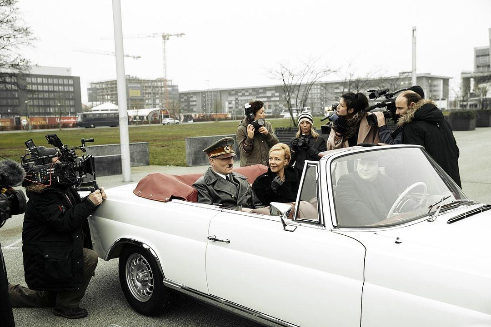

《希特勒回来了》（*Er ist wieder da / Look Who's Back*，2015）最值得说的，是它最后那段——把演员真的扮成希特勒，放进现实街道里去拍普通人的反应。

这一段让它从一部普通的政治讽刺喜剧，突然变成了一个相当尖锐的社会实验。

## 一、它把「希特勒」从历史人物变成了一个测试

电影前面一直在玩一个荒诞的设定：

> 如果希特勒突然出现在今天的德国，他会怎么样？

但传统电影通常会给观众一个很舒服的答案：**当然没人会支持他，因为大家都知道他是恶魔。**

而这部电影故意不这么做。

演员 Oliver Masucci 穿着完整的希特勒服装、化了妆，真的走到德国人中间。导演 David Wnendt 后来明确说，这种现实拍摄本来就是他做这部电影最重要的原因之一：想看看人们究竟会如何对待一个「希特勒」（[卫报的采访](https://www.theguardian.com/film/2015/oct/06/hitler-look-whos-back-director-david-wnendt-interview)）。

结果非常不舒服。

有人和他合影、拥抱、开玩笑；有人甚至表现出明显的亲近和崇拜。Masucci 自己回忆，有人要求拥抱他，也有人真的表现出恐惧甚至攻击性（同上一篇采访）。

于是电影提出了一个比「德国人是否还痛恨纳粹」更可怕的问题：

> **如果把历史记忆拿掉，只剩下一个有强烈个人魅力、会说话、会制造媒体话题的「政治人物」，普通人还认得出危险吗？**

## 二、很多人不是在「支持希特勒」，而是在「消费希特勒」

这一点我认为是电影最聪明的地方。

很多街头路人的第一反应不是「天啊，这是纳粹独裁者」，而是「哈哈，模仿得真像」，然后拿手机拍照。

这其实非常符合现代互联网社会。因为希特勒在 2015 年的德国，已经是一个高度媒介化的历史符号：

> 希特勒 → 纳粹 → 搞笑表情包 → 影视角色 → 网络梗 → 可以合影的「名人」

所以当一个人穿着希特勒制服站在那里时，部分人的第一反应不是历史，而是：**这东西很有趣。**

这甚至比单纯出现几个新纳粹分子更值得警惕。因为新纳粹至少知道自己在拥抱什么；而普通人可能只是觉得「这挺有意思的，我拍张照片」。

电影因此把**历史的娱乐化、符号的消费化、政治人物的明星化**放在了一起。

## 三、「开车经过柏林」这一幕尤其狠

一个穿着纳粹制服的人，坐在敞篷车里，像国家元首一样经过现代柏林。

路人向他挥手。有人欢呼。有人拍照。有人甚至行纳粹礼。而他自己也在挥手。

这个画面实际上是在故意重构纳粹宣传片的视觉语言。而且电影本身的开场就有对莱妮·里芬斯塔尔《意志的胜利》的视觉致敬（[IMDb 的资料页](https://www.imdb.com/de/title/tt4176826/trivia/)），因此这里并不是随便拍一个「希特勒开车兜风」的笑话。

于是你会产生一种非常诡异的感觉：**1930 年代的政治宣传影像，突然在 2010 年代的柏林重新出现了。**

但背景已经变成：智能手机、游客、自拍、社交媒体、现代柏林、普通市民。

这其实就是电影最核心的命题：

> **如果法西斯主义重新出现，它还会长成 1930 年代那个样子吗？**

答案显然是否定的。

## 四、但它不能被当成「德国社会民调」

这一点特别重要。

网上有时候会把最后这些画面理解成「看，德国人原来真的有很多人支持希特勒」，**这其实是过度解读。**

因为这些街头镜头虽然大量使用了真实路人的真实反应，但它们本质上是**电影导演挑选出来的素材**，不是随机抽样调查。导演自己设计了场景，然后把演员带到街头；最终进入电影的，又是导演从大量素材中剪出来的片段。

所以它能证明「这些反应确实真实发生过」，但不能证明「德国人大多数都会这么反应」。这两件事完全不同。

当时德国媒体也特别关注这个问题。《Die Welt》就明确讨论了哪些场景是真实的、哪些是导演设计的，并指出 Masucci 在街头画像等场景中的路人反应是真实的（[WELT 的报道](https://www.welt.de/kultur/kino/article147354280/Er-ist-wieder-da-Die-Filmemacher-ueber-Reaktionen-beim-Dreh-mit-Hitler.html)）。

## 五、正因如此，它作为「电影」比作为「社会实验」更成功

我会给它一个比较高的评价，但**不是因为它证明了德国人仍然有纳粹倾向**。

它真正厉害的是：**它让观众自己产生怀疑。**

你看着那些人笑着和希特勒合影的时候，脑子里会自然冒出一个问题：**如果我生活在 1930 年代，我真的能认出危险吗？**

这才是它真正的刀子。因为观众很容易站在现代人的角度说「我当然不会支持希特勒」，可是电影把问题稍微换了一下：

> 如果这个人不是一开始就告诉你「我是纳粹独裁者」，而是一个很会讲话、很有魅力、很懂媒体、很会制造话题的政治人物呢？

那么答案就没那么简单了。

## 六、电影最后其实完成了一次反转

前半部你是在**嘲笑希特勒**。中间你是在**嘲笑媒体**。到最后，你突然开始**不敢笑了**。

因为你发现真正可怕的不是「希特勒复活了」，而是：

> **如果希特勒真的重新出现，我们是不是仍然会把他当成一个有趣的人？**

而且还有一个更加现代的版本：

> 如果他今天不需要坦克、不需要党卫军，而只需要电视、YouTube、短视频、争议、流量和一群觉得「他说得好有意思」的人呢？

这也是为什么我觉得《希特勒回来了》虽然是一部 2015 年的电影，但它的后半段实际上比它的剧情讽刺更加有生命力。它真正讽刺的已经不只是纳粹，而是**现代民主社会如何把政治人物变成娱乐产品**。

甚至可以说，它最恐怖的一幕不是有人向希特勒行纳粹礼，而是**普通人笑着和他自拍**。

因为行纳粹礼的人，你知道他是谁。

**而自拍的人，你不知道。**（[Die Presse 的评论](https://www.diepresse.com/4839412/er-ist-wieder-da-hitler-erschiesst-deutschen-hund)）

---

## 线索来源

- [David Wnendt 谈《希特勒回来了》的拍摄：The Guardian](https://www.theguardian.com/film/2015/oct/06/hitler-look-whos-back-director-david-wnendt-interview)
- [Er ist wieder da (2015) 花絮：IMDb](https://www.imdb.com/de/title/tt4176826/trivia/)
- [《Er ist wieder da》：摄制组谈拍摄「希特勒」时的反应：WELT](https://www.welt.de/kultur/kino/article147354280/Er-ist-wieder-da-Die-Filmemacher-ueber-Reaktionen-beim-Dreh-mit-Hitler.html)
- [《Er ist wieder da》：希特勒枪杀一条德国狗：Die Presse](https://www.diepresse.com/4839412/er-ist-wieder-da-hitler-erschiesst-deutschen-hund)
