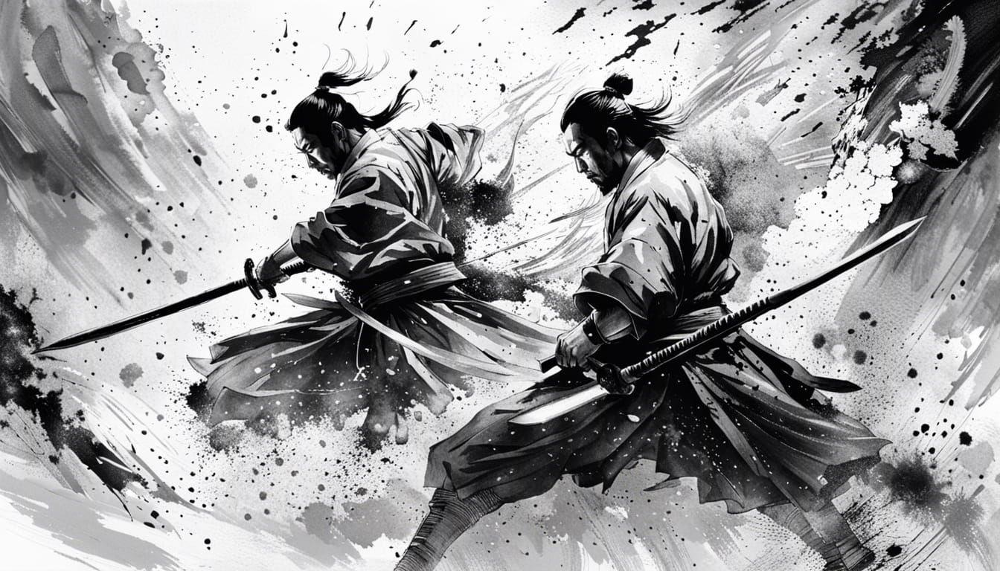
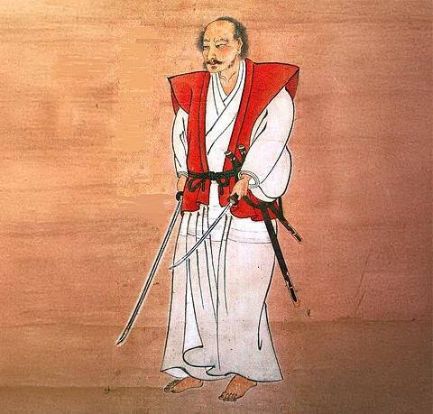
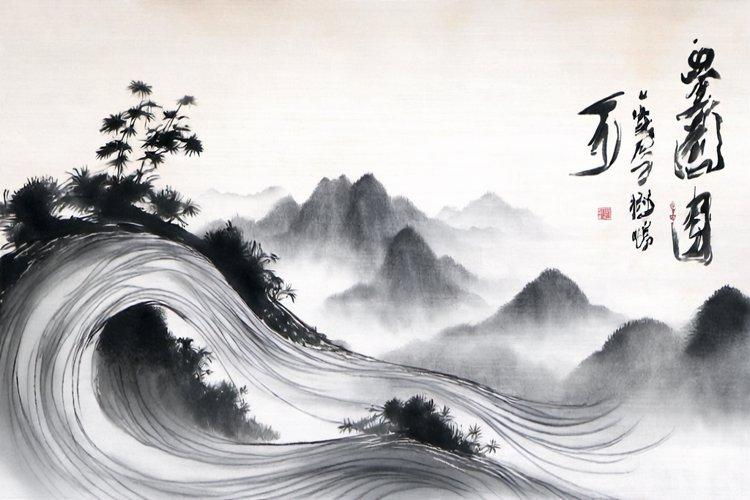
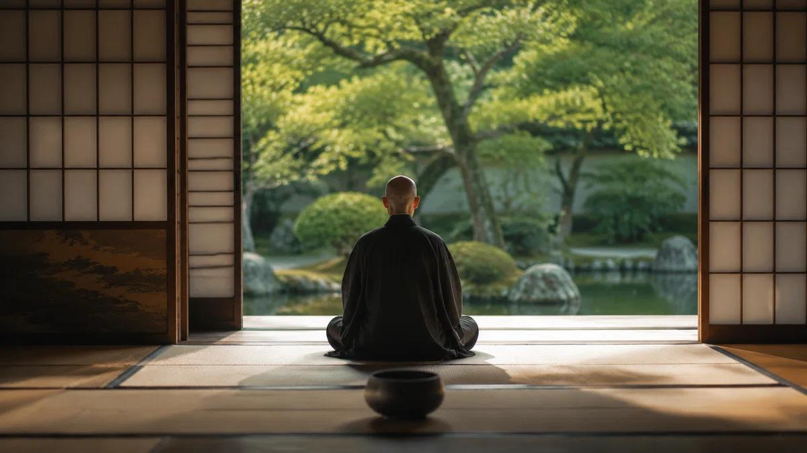

柳生宗矩讲「不滞」，宫本武藏讲「空」，老子讲「无为」，佛陀讲「无我」。四个词分属剑术、兵法、道家与佛家，乍看互不相干，其实都在回应同一个问题：

**人如何摆脱内心的束缚，既不被情绪、欲望和执念控制，又能在现实中清醒地行动？**

正因如此，它们常被放在一起比较。但仔细看就会发现，这并不是同一个道理换了四种说法：四种思想都在不同程度上要求人放下对某种固定状态的执着，但它们关注的对象不同，最终希望达到的境界也不完全相同。

柳生和武藏的剑术思想都受到禅学影响，与佛教存在直接的思想交集；道教的无为则另有自己的哲学根基。[1][2][3] 把四者放到一起对照，反而更能看清每一种思想各自的边界。

## 一、先用一句话理解四者

### 1. 柳生宗矩：不滞——不让心停留在任何一点上

面对敌人，不要被刀、招式、恐惧，甚至「我一定要赢」的念头困住。心可以注意这些事，却不能被其中任何一件事绑住。

**核心：心不被任何对象牵制，因此能够自由应对。**

### 2. 宫本武藏：空——不被成见和既定形式遮蔽

不要以为自己已经掌握了某种招式、规律或道理，就把它当成永远正确的答案。必须通过实践，看清事物实际的状态。

**核心：清除迷惑和成见，认识事物的真实规律。**

### 3. 道教：无为——不以强求和妄动破坏事物的自然进程

不是什么都不做，而是不被焦虑、控制欲和主观意志驱使，非要把事情扳成自己预设的样子。该行动时行动，该等待时等待。

**核心：减少强求，让行动顺应事物的规律。**

### 4. 佛教：无我——不把自我看成固定、独立、永恒的实体

人会执着于「我必须成功」「别人不能否定我」「我就是这样的人」。无我不是否定人的存在，而是看见所谓的自我也在条件、关系和变化中形成，并非一个永远不变的核心。

**核心：看破对自我的固执认定，松开由此产生的执着。**

这里有一个关键区别：柳生的「不滞」是对心的运作状态的要求；武藏的「空」是对心如何认识事物的要求；道教的「无为」是对行动方式的要求；佛教的「无我」则涉及对自我及存在的根本认识。

以上是便于比较的概括，不代表四种思想各自的完整定义。

## 二、四者真正相似的地方：都在对治「执着」

我们可以把四种思想共同面对的心理问题归纳为四种束缚：

- **执着于对象**：眼里只有对手的刀，忽略其他变化。
- **执着于结果**：太想赢，反而无法正常发挥。
- **执着于方法**：认定自己必须按照某个套路行动。
- **执着于自我**：害怕失败，因为失败意味着「我不够优秀」。

四者都能帮助人松开这些束缚，但它们切入问题的角度不同。

| 思想 | 主要松开什么 | 心理上的变化 |
|---|---|---|
| 柳生「不滞」 | 对某个对象、念头或状态的停留 | 注意力恢复流动 |
| 武藏「空」 | 对成见、固定形式和既有认知的依赖 | 看清眼前的实际情况 |
| 道教「无为」 | 强求、妄动和过度控制 | 行动变得顺势而自然 |
| 佛教「无我」 | 对固定自我及其所有权的执取 | 不再凡事都围绕「我」来解释 |

柳生所强调的心不滞留，与禅学中的「不住」和「无心」有密切关联；武藏则将类似的精神要求落实到兵法和实战之中。[4][5][6]

不过，**不执着不等于没有感情，没有目标，或者什么都不在乎。** 真正值得讨论的是：你仍然可以感受、判断、追求和行动，却不再被它们支配。

## 三、最重要的差异：它们对「心」的理解并不相同

### 1. 柳生的「不滞」：心可以停留，但不能被困住

假设对手突然举刀，你的心可能发生这样的变化：

1. 看到刀，注意力被刀吸引。
2. 想到自己可能受伤，产生恐惧。
3. 开始思考该使用哪一种招式。
4. 因为犹豫而错过反击时机。

问题不一定是你不会应对，而是你的心停在了某个地方。

柳生宗矩所强调的，是不要让心停留在对手的刀、自己的招式、恐惧或攻击意图上。注意力应该能够感知整体局势，并随时转向新的变化。[7][2]

这也解释了一个看似矛盾的概念：为什么有些剑术理论会追求「不动心」，却又要求心不断变化？

因为这里的「不动」不是僵硬不变，而是**不被任何东西动摇到失去自由**。

你可以感到恐惧，却不被恐惧夺走判断力；你可以专注于刀，却不至于看不到刀之外的事情。

### 2. 武藏的「空」：不是没有东西，而是不被已有的东西遮住眼睛

武藏在《五轮书》的「空之卷」中讨论的空，并不是简单的虚无。他强调，要通过认识实际存在的事物，也认识自己尚未认识或理解的东西，来理解空。[3][8]

假设你已经练习了一千次某个反击招式。

当对手进攻时，你可能会想：

- 「这种攻击我练过，应该这样反击。」
- 「高手就应该使用这个招式。」
- 「我的流派认为正确的做法是这样。」

这些知识原本是你的优势，但如果你被它们束缚，它们也会成为障碍。

武藏所追求的，不是抛弃训练，而是训练到足够纯熟之后，不再被既有招式、流派观念或思维定式限制。

因此，武藏的「空」可以理解为一种**不被既有认知遮蔽、能够直接认识实际情况的状态**。

这里还要区分两个层次：

- 武藏兵法中的「空」，强调清明的认识、对道的把握以及超越固定形式的能力。
- 佛教的「空」，则涉及一切事物没有独立、固定自性的深层理解。

两者存在交集，但不能直接画上等号。

### 3. 道教的「无为」：不是努力控制自己，而是减少不必要的控制

道教与前两者的差异，在于它特别关注人与自然变化、事物规律之间的关系。

《道德经》的「无为」并不是消极不动，而是不以强制、妄为和私欲任意干预事物。它可以表现为一种顺应规律、没有多余强求的行动方式。[9][10]

还是用剑术举例。

一个人刚学剑时，每个动作都要刻意思考：

- 手应该放在哪里？
- 什么时候应该移动脚步？
- 什么时候应该进攻？

等到训练成熟后，身体能够根据距离、时机和对手的动作自然反应，不必每一步都由意识发号施令。

这与「不滞」很接近，但关注点有所不同：

- **不滞**：不要让心卡在某个念头或对象上。
- **无为**：不要让多余的主观干预破坏恰当的行动。

前者更强调心的自由流动，后者更强调行动与事物规律的协调。

当然，熟练的自动反应只是一个便于理解的例子，并不意味着道教无为的全部内涵都可以还原为运动技能。

### 4. 佛教的「无我」：甚至连「我正在修炼得更好」也值得反思

无我比前三者触及的问题更根本。

一个人可能已经能够做到：

- 不被恐惧影响判断。
- 不被固定招式束缚。
- 不强求事情按照自己的计划发展。

但他仍然可能非常执着于自己的身份。

例如：

「我是一个冷静的人，所以我不能失态。」

「我是一个高手，所以我不能输。」

「我已经看破执着，所以我不应该有执着。」

这些念头都可能形成新的束缚。因为人开始维护一个固定的「我」的形象。

佛教的无我并非要求人否定自己的存在，而是要认识到：所谓的自我并不是一个独立不变、可以完全掌控一切的实体。身体、感受、认知、意志和意识都在因缘条件下变化。

因此，无我不仅是放下某个念头，还涉及放下对「这个念头属于一个固定的我、必须由我控制、必须证明我是谁」的执取。

这也不意味着佛教认为人不需要承担责任。恰恰相反，不再被自我防卫支配，反而可能让人更清楚地面对自己的行为及其后果。

## 四、把四者放在同一场冲突中

设想一个人在工作中受到不公平的批评，他很愤怒，想立即反驳。四种思想分别会给出怎样的应对？

- **柳生：不滞**——他察觉到愤怒，但不让心停在愤怒上；也不反复回想对方那句话，而是继续观察现场、判断对方的意图和当前局势。
- **武藏：空**——他不急于套用「对方就是在羞辱我」的解释，也不认为自己必须按照某种固定的方式回应，而是先看清事实。
- **道教：无为**——他不急于压服对方、证明自己正确或立刻扭转局面。先判断什么行动真正有用：可能是解释事实，也可能是等待合适的时机。
- **佛教：无我**——他进一步观察：为什么这句话会让人如此愤怒？是不是把别人的评价当成了对自身价值的判决？即使被误解，是否仍然可以处理问题，而不必把全部精力用来维护自尊？

当然，这不是说无我一定比无为高、无为一定比不滞高，而是用同一情境展示它们不同的观察角度。

四者都可能让人避免冲动反应，但它们所揭示的问题并不相同。

## 五、它们之间最深的差异

如果再往深处走，可以从三个问题来区分它们。

| 问题 | 柳生不滞 | 武藏之空 | 道教无为 | 佛教无我 |
|---|---|---|---|---|
| 我应该如何面对念头？ | 不停滞、不受困 | 不被成见遮蔽 | 不以强求驱使自己 | 观察念头，不执为「我」 |
| 我应该如何行动？ | 自由应对变化 | 根据实际情况判断 | 顺应规律，减少妄为 | 以智慧处理因缘，不执取自我 |
| 最核心的关注点 | 心的灵活性 | 认识与实践的清明 | 人与道的协调 | 对自我及一切法的执取 |

这里有一个容易被忽略的事实：**四者并不处在完全相同的哲学层级。**

「不滞」主要可以作为一种修心和行动原则来理解；武藏的「空」同时涉及兵法认识与实践；无为是道家关于道、自然和行动的重要思想；无我则是佛教关于存在、自我与解脱的核心教义之一。

如果只把它们理解成四种提高专注力的方法，就会错过它们最有意思的差异。

## 六、把它们放进现代人的修心

与其把它们当成四个必须依次通关的境界，不如视为四种互补的能力。

- **用不滞处理情绪：** 我可以感到愤怒，但不必被愤怒控制。
- **用空处理认知：** 我现在相信的，不一定就是全部事实。
- **用无为处理行动：** 我不需要控制每一个细节，才能把事情做好。
- **用无我处理自尊：** 事情失败，不等于我的整个人生价值都被否定。

最后还有一个共同点值得强调。

真正的修心，并不是把自己训练成一个没有欲望、没有情绪、没有判断的人。

而是让你即使有欲望、有情绪、有目标，也仍然拥有选择的自由。

**不滞，是心不被困住；空，是眼不被蒙蔽；无为，是行动不被强求扭曲；无我，是不必时时刻刻维护一个固定的自己。**

四者相通之处在于减少束缚，差异则在于：它们分别从心的运作、认识的清明、行动的自然，以及自我的根本认定入手。

## 参考文献

1. 柳生宗矩《兵法家传书》相关研究 — KCI 期刊文章 — https://www.kci.go.kr/kciportal/ci/sereArticleSearch/ciSereArtiView.kci?sereArticleSearchBean.artiId=ART002896718
2. The Life-Giving Sword（《活人剑》）— Shambhala Publications — https://www.shambhala.com/the-life-giving-sword-2818.html
3. Kokoro wa kū（心空）— Miyamoto Musashi Quotes — https://miyamoto-musashi.org/en/quotes/kokoro-wa-ku/
4. mushin（无心）— Book of Five Rings Glossary — https://miyamoto-musashi.org/en/glossary/mushin/
5. heijōshin（平常心）— Book of Five Rings Glossary — https://miyamoto-musashi.org/en/glossary/heijoshin/
6. fudōshin（不动心）— Book of Five Rings Glossary — https://miyamoto-musashi.org/en/glossary/fudoshin/
7. Heihō Kadensho（兵法家伝書）— Tsushima Shiki — https://tsushima-shiki.com/en/kenjutsu/heiho-kadensho.html
8. Musashi's Thought（武藏的思想）— https://miyamoto-musashi.org/en/thought/
9. Daoism — Stanford Encyclopedia of Philosophy — https://plato.stanford.edu/archives/fall2023/entries/daoism/
10. Laozi — Stanford Encyclopedia of Philosophy — https://plato.stanford.edu/entries/laozi/
